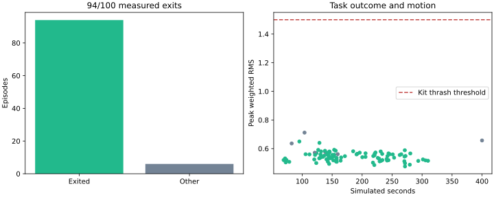

# RIGHT HAND RULE

A blindfolded, free-standing Unitree G1 finds its way through a maze by touch. Its right arm feels the wall; its left arm probes ahead. The complete task controller receives **joint state and pelvis IMU only**: no camera, lidar, supplied map, simulator position or contact-force sensor.

Navigation and arm compliance are scripted. Locomotion uses NVIDIA's attributed pretrained GR00T Walk and Balance networks, exported to equivalent NumPy inference. All robot motion comes from joint control; the maze is static collision geometry.

> Development branch for the pre-submission review. Results below describe the preserved `v1.0.0` release. Current controller experiments are not qualified for submission; see `review/COMPETITIVE_AUDIT.md`.

## Results

[Measured tables, failures and counterfactuals](evaluation/results/RESULTS.md) · [Force and touch-map figure](evaluation/results/force-and-touch-map.svg)



| Measurement | Result |
|---|---|
| Untouched randomized episodes, nominal timing | **94/100 exits** within 400 simulated seconds |
| Falls / checker stops / actual limit findings | **0 / 0 / 0** in the primary split |
| Median successful episode | **157.42 s** |
| Peak primary thrash | **0.712 / 1.500** |
| Maze diversity | **14 distinct topologies**, with independently randomized dynamics, sensors, width and start pose |
| Neutral / touch-off / delayed-touch controls | **0/10 exits each**, on matched seeds |
| True map + basic no-touch dead reckoning | **0/10 exits**; explicitly privileged evaluator-only baseline |
| Exact image, native ARM64 | **3/3 standard and 3/3 maze runs: `simulation_checks_complete`**, with all three maze exits scored from kit traces |
| NumPy vs ONNX Runtime | 10,000 recorded histories per network; maximum action difference **3.58×10⁻⁶**, below 10⁻⁴ |

The 100 episodes are not 100 distinct mazes. The observed exit-rate Wilson interval is 87.5–97.2%. Six navigation failures remain in the denominator. Full results, parameter draws and independent re-scoring are in `reports/` and the release evidence downloads. Native runs: [three repeats and counterfactuals](https://github.com/Marc-Dvci/right-hand-rule-g1/actions/runs/42656538931).

**Scope:** these results establish the declared simulation task at nominal timing. Added command delay is a material limit: 20 ms stress exited 4/5; 40 ms exited 0/5 with angular-speed stops. Raw contact impulses reached 175.36 N in the primary split. No physical robot performance or hardware authorization is claimed. [PROJECT_AUDIT.md](PROJECT_AUDIT.md) records every material departure from the original plan, including gates not met or not executed.

## Run it

Use Python 3.12 on Linux. Rendering uses EGL and DejaVu fonts. Dependencies are pinned in `requirements.txt`; MuJoCo is 3.3.7. The image contains its dependencies and needs no installation at startup.

```bash
python3.12 -m venv .venv
source .venv/bin/activate
pip install -r requirements.txt
./run.sh
```

`run.sh` runs the tests, verifies the final source freeze, evaluates development maze 0 with the submitted configuration, and renders a video from saved states. `python screen_maze.py --seed 0` is a small reusable task screen. Add `--randomize` for the declared perturbations.

To reproduce the entire frozen primary split, use a new output directory:

```bash
python harness/cohort.py --final --name final-reproduction --workers 4 --seconds 400 \
  --randomize --transport --latency-steps 0 \
  --parameters config/navigation.json --transport-config config/deployment.json
```

To test the complete ROS 2 image on native ARM64:

```bash
# Download submission.tar from the release and verify its SHA-256 first.
docker load -i submission.tar
python screen_maze.py --container --seed 0 --seconds 300
```

The maze screen generates its scene and assets, runs the real ROS kit and independently scores the saved base trajectory. Local x86 Docker needs a compatible ARM64 emulator; emulated reports remain separate from native evidence. `bash tools/build_container.sh` rebuilds from source; a rebuild must be qualified again, because the tested artifact is the exact released archive.

## What was measured

The harness imports HIM's original `Runner`, `Plant`, startup balance, checker and enforced thrash detector. An explicit allowlist passes only `q`, `dq`, quaternion and gyro into the policy. Simulator truth stays in the evaluator for scoring, force comparison and replay. Tests replace privileged fields with invalid values and verify bitwise-identical output.

Success requires an outward crossing through the designated exit segment before returning through the entrance. A latched stop, time limit or checker failure remains a failed episode. The controller has no privileged exit signal; the harness ends a successful episode at the crossing. The longer native runs continue after exit. `tools/audit_final.py` independently re-scores all 100 full local traces and verifies the exact seeds, randomization draws, configuration and source digest. Final seeds were never used for tuning.

The primary distribution randomizes corridor width, wall/hand/effective floor friction, link mass/inertia, motor force caps, joint friction loss, encoder/IMU/gyro noise, yaw drift and start pose. Additional full-frame latency is a separately reported stress, declared before final evaluation. There are no moving obstacles, uneven terrain or body pushes in this split.

All six starts were attempted on both native scenes. Standing passed. Floor/seated starts did not reach policy handoff: recorded cases exceeded startup checks, and three maze poses were rejected for substantial initial penetration. Both counterfactual suites return `review_required`; they are **not** all-pose passes.

The canonical vendor kit is unchanged and hash-verified. Standard runs use it directly. Task runs use an isolated copy with **one disclosed report-export change**: the post-run `report` RPC gets 60 s instead of 10 s. Physics, gains, safety checks, active control and freshness deadlines remain unchanged. The first unpatched task report timed out during export. Invocation records contain the exact patch and hashes.

The warning dictionary distinguishes actual torque/speed findings from diagnostic target clipping. Both are retained. `within_limits` alone is never used as a container qualification or task-success claim.

## What a real attempt needs

HIM must qualify the complete image, effective torque response, timing, hand surface and force estimate. Begin with an instrumented compliant wall under HIM's normal tether and emergency stop, then one corner. The inferred force guard cannot bound transient physical hand forces. Added waist feedback is sensitive to delay; the logging-only touch map has substantial odometry drift. See [HARDWARE_ATTEMPT.md](HARDWARE_ATTEMPT.md) and [SENSOR_CONTRACT.md](SENSOR_CONTRACT.md).

## Artifacts and dependencies

[The release](https://github.com/Marc-Dvci/right-hand-rule-g1/releases/tag/v1.0.0) holds the contest ZIP, 82-second film, exact ARM64 image, all 100 portable base trajectories, native evidence and SHA-256 inventory. ZIP + film stay below the contest's combined 100 MB limit; the larger image/evidence files are separate downloads. The ZIP includes all final episode reports, full hero/control traces, independent ONNX fixtures and reproducible source. Full local policy-channel traces are retained and fingerprinted; the portable trajectory archive selects time/qpos without resampling. Verify it with `tools/check_motion_archive.py`.

`g1-runner.json` references the complete controller image and declares only `joint_state` and `imu`. No gait-only Arena screening manifest is supplied. The film replays saved qpos; it never advances dynamics or changes outcomes. Wall transparency is a rendering choice.

The custom scene preserves the free base, all 29 joints/actuators, IMU and original inertial parameters. It disables the original palm collision spheres and uses disclosed low-friction hand capsules representing a surface treatment. The blindfold is visual only. NVIDIA model provenance/licenses, Unitree notices and original kit files are included; see [THIRD_PARTY_NOTICES.md](THIRD_PARTY_NOTICES.md). [WORK_LOG.md](WORK_LOG.md) preserves the development corrections and rejected experiments.
