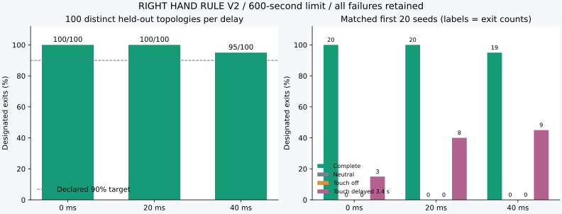
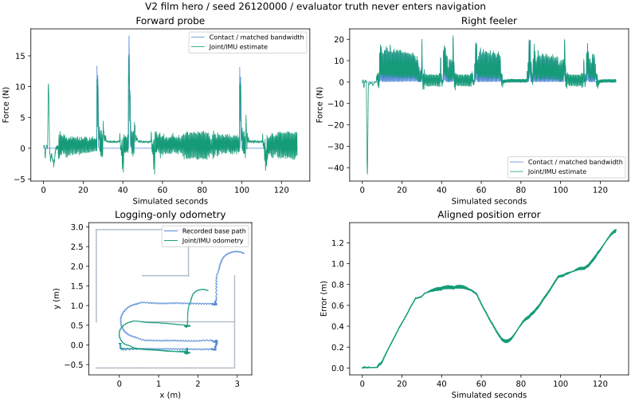

# RIGHT HAND RULE V2: measured results

A whole contact-navigation controller on joint state and pelvis IMU only. Navigation is scripted; locomotion uses attributed pretrained NVIDIA GR00T networks. No camera, supplied layout, simulator position or contact labels enter the deployed controller.

## Frozen geometry holdout

The 100 distinct 3x3 spanning-tree topologies exclude all 92 development topologies and every retired V1 layout. Source/settings were frozen before opening these episodes. Each trial allows 600 simulated seconds; all failures remain in the denominator.

| Command delay | Exits | Checker stops | Actual limit findings | Median success | Peak thrash |
|---|---:|---:|---:|---:|---:|
| 0 ms | 100/100 | 0 | 0 | 171.49 s | 0.766 |
| 20 ms | 100/100 | 0 | 0 | 205.69 s | 0.584 |
| 40 ms | 95/100 | 0 | 0 | 243.96 s | 0.701 |

Declared primary gate: **passed**. This is a simulation qualification for the declared distribution, not a common benchmark against other Arena tasks.

## Matched controls

First 20 seeds, identical geometry/settings/randomization at each delay. `touch_shuffled` is the historical name for a fixed 3.4-second delay, not random shuffling.

| Intervention | 0 ms | 20 ms | 40 ms | Limit findings (0/20/40 ms) |
|---|---:|---:|---:|---:|
| Complete | 20/20 | 20/20 | 19/20 | 0 / 0 / 0 |
| Neutral | 0/20 | 0/20 | 0/20 | 0 / 0 / 0 |
| Touch off | 0/20 | 0/20 | 0/20 | 0 / 0 / 0 |
| Touch delayed 3.4 s | 3/20 | 8/20 | 9/20 | 0 / 3 / 6 |

## Exact-image native ARM64 evidence

Standard: **3/3** clean; actual maze: **3/3** clean, **3/3** designated exits. Peak native thrash: 0.379.

Archive SHA-256: `db0ed1194f03a71d706f161e2ee1fbf368a09f3632dd5ff36329f9d303d00051`.

[Native workflow](https://github.com/Marc-Dvci/right-hand-rule-g1/actions/runs/42811969249). Standard runs use the canonical kit. Task runs disclose a report-export-only RPC extension from 10 to 60 seconds. Plant, active deadlines and checks are unchanged. All six starts were attempted on both scenes; startup failures and invalid penetrations remain recorded. Both suites require review; this is not an all-pose pass.

## Version-matched supporting evidence

- Constant command age identified correctly in **300/300** held-out primary trials. The controller receives no evaluator delay label; fit confidence remains a relative residual heuristic.
- Fresh development qualification: 276 episodes across all 92 development layouts and all three delays; see `reports/v2/development-summary.json`.
- Separate damping/push stresses: 16/16 exits, 0 checker stops and 0 actual limit findings.
- Sensor-only command proof: **7,797 calls**, maximum target/feedforward difference **0.0**, MuJoCo imported: **False**. The bundle contains only joint/IMU observations, host readiness, sequence IDs and expected outputs compared after inference.
- Original locomotion export parity: 10,000 recorded histories per network, maximum action difference 3.58e-6. This validates the pretrained network export, not hardware transfer.
- Independent final audit checks exact source, config, dependencies, seeds, walls, randomization, active checks and geometric crossing scores. Portable motions can be rescored without a physics engine.

A neutral-control process failed before model/policy initialization because its generated scene was unavailable on the shared Windows-mounted path. The original log is retained; only that missing trial was rerun on a byte-identical frozen Linux copy. The remaining controls used that copy as well. No policy, physics, settings, seed or outcome was changed; see `review/results/v2-infrastructure-incidents.json`.

## Force-estimator and odometry audit

The disclosed film hero has **1.633 N component RMSE** and **2.828 N mean-hand vector RMSE**, 39.1% of the 7.236 N target. These use causally aligned, bandwidth-matched evaluator forces after startup. Historical fields named `force_vector_rmse_n` average components; the new analysis explicitly distinguishes vector-norm RMSE. The original 25% force-error goal is not passed under the vector definition.

Its aligned endpoint odometry error is **1.325 m**. This is one disclosed demonstration, not a cohort-wide estimator guarantee. The trajectory/map remains logging-only.

## Material limits and improvements still needed

- Peak final hand load: **142.55 N**; peak nonhand wall load: **560.66 N**. These are 500 Hz sums of individual contact magnitudes. The original 20 N gate remains unmet; softened arms sometimes transferred load to the body.
- Instrumented compliant-wall qualification and improved collision avoidance/compliance are the highest priorities before hardware. Inferred-force thresholds do not bound transient load.
- Calibration assumes a free-space start and a constant 0/20/40 ms command age. Arbitrary varying delays, hardware actuator filtering and model mismatch remain unqualified.
- Foot odometry drifts. The touch map and wall-heading fit remain logging-only; no memory traversal or guided-hand mode is implemented.
- The supplemental 50-run wall/inner/outer sets are reported below. The original full low-force goal remains unmet. Broader geometry and dynamic-obstacle qualification remain unexecuted. This is a 3x3 perfect-maze task.
- Physical G1 results, all-pose recovery and hardware authorization are absent. Simulation reliability does not establish universal superiority over competitors on different tasks.

## All primary failures

| Delay | Seed | Layout | Seconds | Outcome / last state |
|---|---:|---:|---:|---|
| 40 ms | 26120014 | 163 | 472.44 | navigation hold / STOP |
| 40 ms | 26120021 | 72 | 512.48 | wrong entrance / ARC |
| 40 ms | 26120032 | 132 | 222.68 | wrong entrance / FOLLOW |
| 40 ms | 26120040 | 25 | 188.06 | wrong entrance / ARC |
| 40 ms | 26120065 | 34 | 369.24 | wrong entrance / ARC |

## Supplemental original-plan primitives

These 150 nominal-delay trials were declared and executed after the frozen geometry holdout, with the same unchanged controller. Each primitive uses 50 fresh randomized seeds and a 150-second budget. Corner scores below are geometric exit crossings in the authored L-wall scenes; they do not establish a physical low-force corner envelope.

| Primitive | Exits | Checker stops | Limit findings | Peak hand load | Peak body-wall load |
|---|---:|---:|---:|---:|---:|
| wall | 50/50 | 0 | 0 | 57.59 N | 0.00 N |
| inner | 50/50 | 0 | 0 | 83.56 N | 0.00 N |
| outer | 50/50 | 0 | 0 | 89.79 N | 112.40 N |

Straight-wall runs meeting the complete exit/contact-distance/20 N condition: **0/50**. Wall contact onsets detected within 200 ms: 99.74%; false-contact sample fraction: 94.14%; wall runs meeting the vector-RMSE goal: 0/50. The instantaneous false-contact comparison includes short gait-contact gaps while the filtered navigation signal remains positive; the declared 1% criterion is unmet. The exact thresholds, sample definitions and per-run values are in the declared protocol and `reports/v2/primitive-summary.json`. This supplemental set is not the 100-topology holdout and was not used to retune V2.

Full per-episode reports, hashes, controls and native outcomes are included in the source ZIP and release evidence. The film uses measured states only; hero/grid selection is the first four successful nominal seeds, disclosed in `dist/result.json`.
